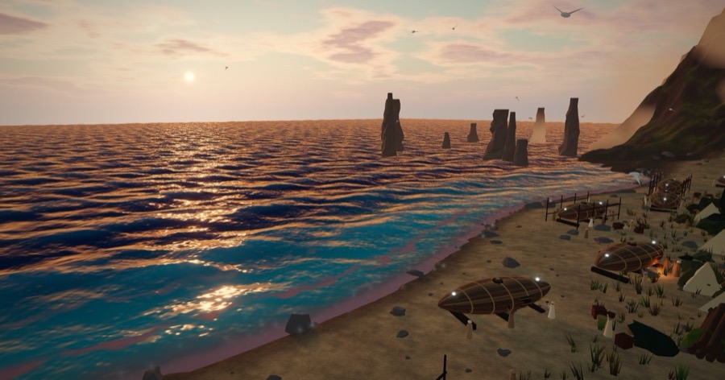
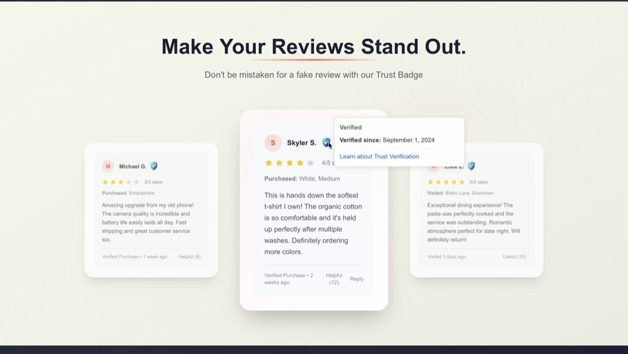
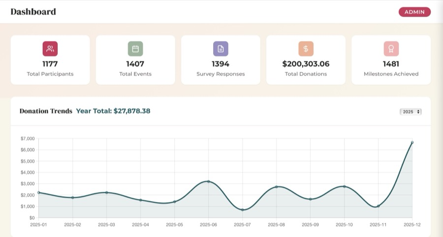

# Skyler Smith

I build AI tools that make real work faster.

I'm an AI Enablement & Automation Intern at [Pattern](https://pattern.com) and a senior at BYU studying Information Systems with a Computer Science minor, graduating April 2027.

**Open to new-grad applied AI, forward-deployed, and product engineering roles.**

[Portfolio](https://skylersmith.me) · [Resume](https://skylersmith.me/resume/skyler-smith-resume-2026.pdf) · [LinkedIn](https://www.linkedin.com/in/skyler-smith1) · [Email](mailto:osideskyler@gmail.com)

## Featured projects

<table>
  <tr>
    <td width="45%"></td>
    <td>
      <h3>Brother of Jared</h3>
      
An interactive 3D retelling of the Jaredite barges story from the Book of Mormon that runs in the browser. It has shader-driven water and fire, a Blender-built animated crowd, and story chapters you can walk through. Quality tiers and automated frame-time tests keep it smooth on laptops and phones.

      
<b>Stack:</b> three.js, GLSL, Blender, Vite <a href="https://brotherofjared.skylersmith.me">Live demo</a>

    </td>
  </tr>
  <tr>
    <td width="45%"></td>
    <td>
      <h3>Trust Scores</h3>
      
A full-stack platform that verifies online reviewers with facial recognition, built with a BYU professor to turn research into a working product. Verification takes about 10 seconds and cut cost per user by 98%.

      
<b>Stack:</b> React, Go, AWS, Supabase, OAuth <a href="https://skylersmith.me/projects/trust-scores-app">Case study</a>

    </td>
  </tr>
  <tr>
    <td width="45%"></td>
    <td>
      <h3>Ella Rises</h3>
      
<b>1st place, BYU IS Core INTEX competition.</b> A team-built management dashboard and custom AI agent that helps a nonprofit's leaders get useful insights from their data.

      
<b>Stack:</b> Dashboards, data visualization, AI agent <a href="https://skylersmith.me/projects/ella-rises-intex">Case study</a>

    </td>
  </tr>
</table>

### More projects

- **[AI Discussion Board](https://github.com/osideskyler/byu-discussion-board):** A class Q&A board where students get instant Gemini-generated help with R code and errors. Built with Flask and SQLite.
- **[Shop Pipeline](https://github.com/osideskyler/shoppipeline):** A late-delivery prediction pipeline that runs ETL, model training, and batch inference into Postgres on GitHub Actions.
- **AI Facebook Marketplace Agent:** Hackathon honorable mention. Automates buyer conversations and calendar scheduling.
- **[BYU QIB website](https://byu-qib.vercel.app):** A React and Vercel site for BYU's Quant in Business Society.
- **[Portfolio site](https://github.com/osideskyler/skylerswebsite):** Built with Next.js, TypeScript, Tailwind CSS, and three.js.

## Experience

**AI Enablement & Automation Intern, Pattern** · Apr 2026 to present
- Map team workflows with managers and build custom MCP servers for enterprise data access
- Help govern the rollout of 50+ team plugins and 300+ Claude skills
- Lead biweekly advanced AI sessions for 20+ reps

**Product Specialist, Redo** · Oct 2025 to Apr 2026
- Built a claims dashboard for internal analytics and process automation, and served as subject matter expert for a $180k/month pipeline
- Resolved 500+ technical issues with perfect CSAT and turned customer feedback into 30+ product enhancements

**Product Engineer, Brigham Young University** · Jun 2025 to Oct 2025
- Built the Trust Scores verification platform, including an SDK designed for future enterprise use

## Skills

- **Languages:** TypeScript, Python, SQL, C#, Go
- **AI:** Claude Code, MCP servers, Claude skills and plugins, LLM APIs, agentic workflows, n8n, Cursor
- **Web and data:** React, Next.js, Supabase, AWS, Tableau
- **3D and graphics:** three.js, GLSL, Blender

## About me

- 3.73 GPA and BYU full-tuition scholarship
- Vice President of Student Experience, BYU Developers Club
- Speak Spanish from two years of volunteer service in Mexico City
- Eagle Scout
- Half of a DJ duo, and I spend the rest of my free time surfing, snowboarding, mountain biking, and playing electric guitar
